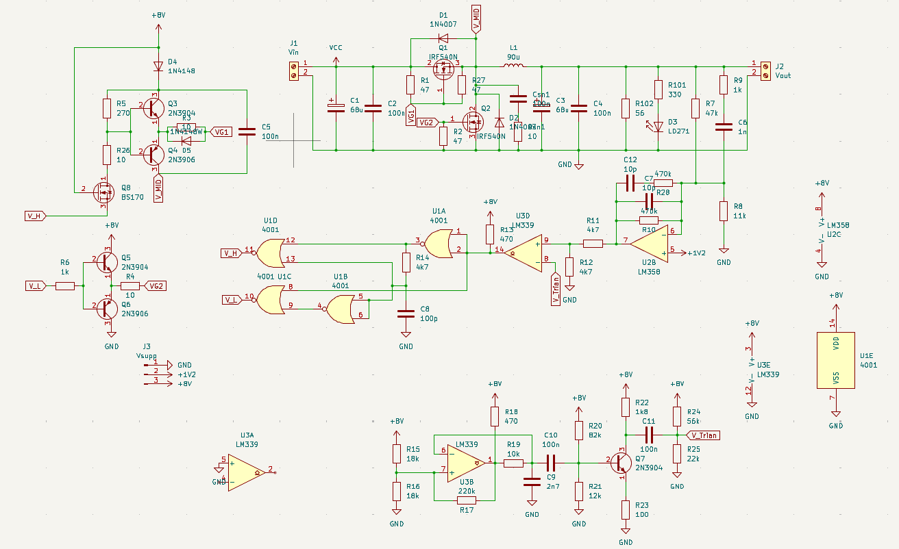
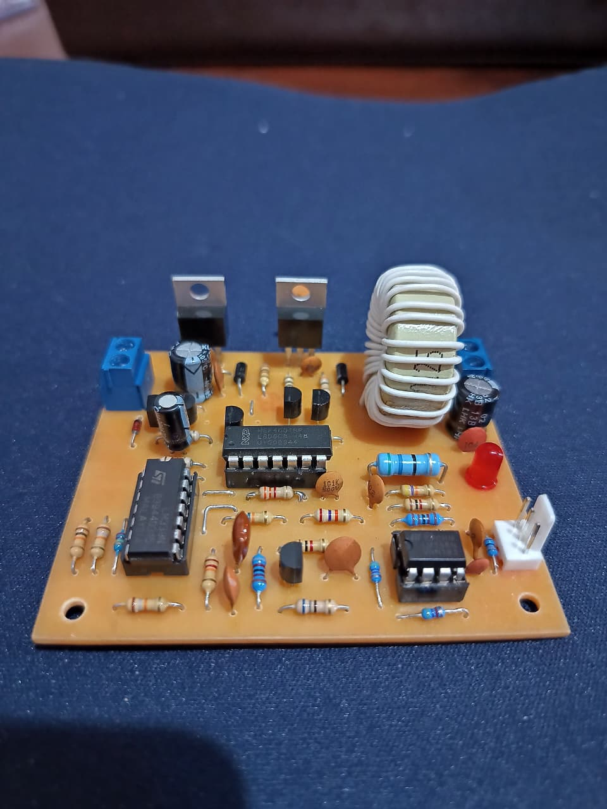
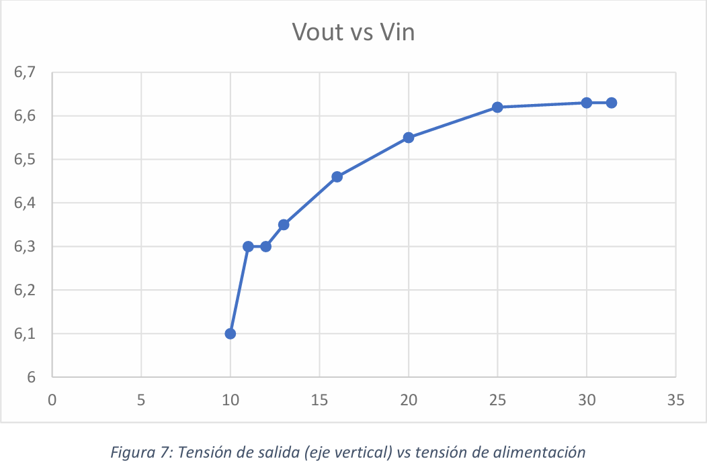
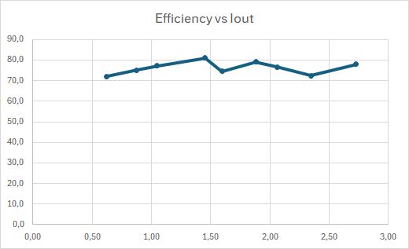
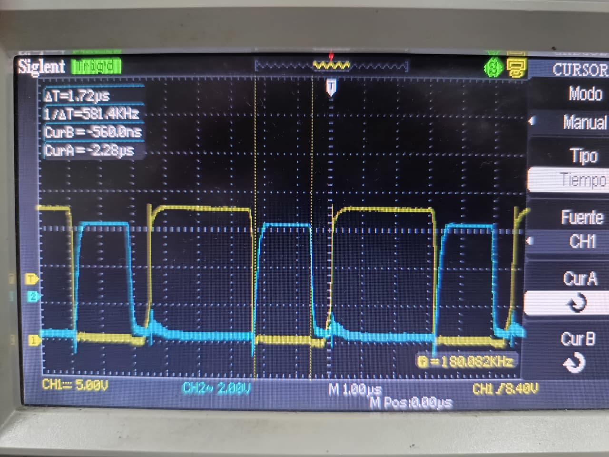

# Discrete-Synchronous-Buck-Converter
A discrete synchronous Buck converter operating at 200 kHz, capable of stepping down an input voltage from 12–36 V to a regulated 6.35 V output delivering up to 2.25 A with >70% efficiency.

## 📸 Gallery

## 🎯 Main Features
- Discrete closed-loop control system operating at **200 kHz**.
- Synchronous rectification architecture for optimized power conversion efficiency (>70–80%).
- Broad input voltage acceptance range (**12 V – 36 V DC**).
- Regulated output voltage of **6.35 V** supporting up to **2.25 A** continuous current load.
- Custom discrete modules: Error Amplifier, Triangle Wave Generator, Dead-Time Logic, and Gate Drivers.

## 🛠️ Technology
- **Control & Switching Topology:** Discrete Component Design (MOSFETs, BJTs, Op-Amps, Comparators, NOR Logic)
- **Primary Components:** LM339, CD4001 NOR Gates, 2N3904 / 2N3906 BJTs, Custom Ferrite Core Inductor
- **Design Tools:** MATALB & LTSPICE Simulation
- **PCB Design:** KiCad

## 💡 Architecture and Technical Challenges

### 🔄 Discrete PWM & Closed-Loop Regulation
Instead of using an integrated PWM controller IC, the feedback and control loops are fully realized using discrete components:
- **Error Amplifier Stage:** Implements a proportional-integral (PI) compensation network ($R_{10}$ and $C_7$) paired with an RC feedback filter to secure closed-loop stability. A precision resistor divider scales the error voltage (8 V down to 4 V) to map directly onto the triangle wave dynamic range.
- **Custom High-Frequency Triangle Generator:** To bypass typical operational amplifier bandwidth limits at 200 kHz, the circuit generates a ramp signal via RC charge/discharge dynamics on $C_9$, subsequently amplified through a discrete BJT stage ($Q_7$) to produce a clean 5 V peak-to-peak ramp for PWM comparison.

### ⏱️ Dead-Time Logic & High-Side Gate Driving
- **Cross-Conduction Prevention (Dead-Time):** To prevent shoot-through currents across the main switching MOSFET ($Q_1$) and synchronous MOSFET ($Q_2$), a discrete logic circuit utilizing $RC$ delays ($R_{14}, C_8$) combined with CMOS NOR logic gates inserts a precise non-overlapping dead-time gap between gate drive signals.
- **Bootstrap High-Side Driver:** Driving the high-side floating N-channel MOSFET ($Q_1$) requires a gate voltage exceeding the primary supply rail ($V_{in}$). A bootstrap network ($D_1, C_5$) charges when the switching node is pulled to ground, boosting the upper supply rail by +8 V during conduction. High-side signal translation is handled through open-collector comparators (LM339) driving a discrete BJT Totem-Pole stage ($2N3904 / 2N3906$).

### ⚡ Performance & Efficiency Considerations
- **Parasitic Mitigation:** High-frequency parasitic ringing at $200\text{ kHz}$ was mitigated by inserting $G\text{-}S$ capacitors across the switching MOSFETs to suppress transient $dV/dt$ false turn-on spikes.
- **Custom Ferrite Inductor:** Inductance was calculated and manually wound based on ferrite core magnetic loss specs to sustain Continuous Conduction Mode (CCM) across line and load variations.

## 🚀 Measurement Tests & Performance

